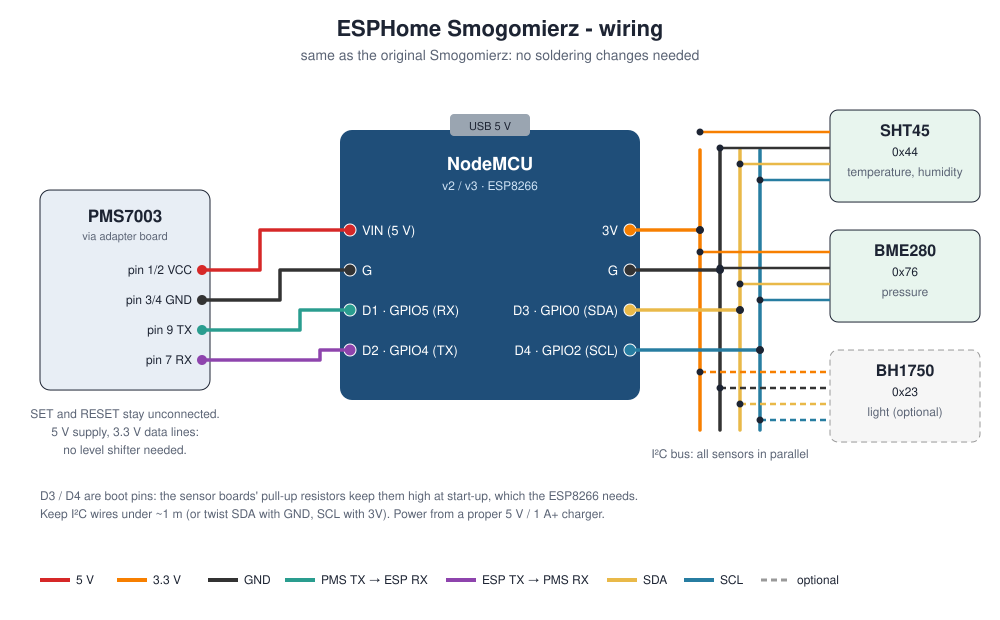

# ESPHome Smogomierz 2.0

Outdoor **air-quality station** for Home Assistant: PM1 / PM2.5 / PM10, temperature,
humidity, pressure (and optionally light) on a NodeMCU with **ESPHome** firmware.

Inspired by the popular Polish DIY project
[Smogomierz / Smogly](https://github.com/hackerspace-silesia/Smogomierz) by Hackerspace
Silesia, it runs on the same hardware **with the same wiring**. If you have an old Smogomierz box, flash this
firmware and it shows up in Home Assistant, with optional upload to the public
[Sensor.Community](https://sensor.community/) map.

## What you get in Home Assistant

| Entity | Notes |
|---|---|
| PM1.0, PM2.5, PM10 (µg/m³) | PMS7003 laser sensor, measured every 2 min (sleeps in between) |
| Temperature, Humidity | SHT45, stable outdoors |
| Pressure, Pressure (sea level) | BME280; sea level uses your altitude |
| Dew point | calculated |
| PM readings unreliable (humidity) | on above 85 % humidity: fog makes optical PM read too high |
| Illuminance | optional BH1750 |
| WiFi signal, Uptime, Status | diagnostics |
| Sensor.Community upload (switch), Sensor.Community ID | sharing, off by default |

## Hardware

- **NodeMCU v2 or v3** (ESP8266, ESP-12E)
- **Plantower PMS7003** + adapter board (10-pin 1.27 mm)
- **SHT45** breakout: temperature and humidity
- **BME280** breakout: pressure (its humidity tends to drift outdoors, hence the SHT45)
- optional **BH1750** light sensor
- a **proper 5 V / 1 A+ USB charger**: weak USB power makes the PMS7003 send garbage
  (`Start character 1 mismatch` in the log)

### Wiring

| From | To NodeMCU |
|---|---|
| PMS7003 pin 1/2 VCC | VIN (5 V) |
| PMS7003 pin 3/4 GND | G |
| PMS7003 pin 9 TX | D1 (GPIO5) |
| PMS7003 pin 7 RX | D2 (GPIO4) |
| I²C VCC (all sensors) | 3V |
| I²C GND (all sensors) | G |
| I²C SDA (all sensors) | D3 (GPIO0) |
| I²C SCL (all sensors) | D4 (GPIO2) |

All I²C sensors connect in parallel. D3/D4 are ESP8266 boot pins; the breakout boards'
pull-up resistors keep them high, which is what the board needs to start. The small
blue LED on D4 may flicker; that is normal.

## Installation

1. Copy `smogomierz.yaml` into your ESPHome configuration folder (ESPHome add-on,
   dashboard or command line).
2. Copy `secrets.yaml.example` to `secrets.yaml` (or add the keys to your existing
   one) and fill in Wi-Fi and a fresh API key (`openssl rand -base64 32`).
3. Adjust the `substitutions:` at the top: at least your **altitude**.
4. First flash over USB (ESPHome web flasher or `esphome run smogomierz.yaml`), later
   updates over Wi-Fi.
5. Home Assistant discovers the device; add it with the same API key.

## Sharing on Sensor.Community

1. In Home Assistant, note the **Sensor.Community ID** (`esp8266-<chip id>`).
2. Register the station at [devices.sensor.community](https://devices.sensor.community/)
   with that ID and two sensors: **PMS7003 (pin 1)** and **BME280 (pin 11)**.
   Temperature and humidity are sent from the SHT45 under the BME280 entry.
3. Switch on **Sensor.Community upload**. Readings are sent every 145 s.

## Tips

- **Placement:** ~1.5–3 m above ground, out of direct sun, rain and exhaust, with free
  air flow to the PMS7003 inlet. A radiation shield for the SHT45 improves temperature
  readings.
- **Sensor life:** the PMS7003 fan and laser last about 8,000 hours non-stop. With the
  default 120 s interval the sensor sleeps between readings, which multiplies its life.
- **Fog:** optical PM sensors over-read in very humid air. Use the "PM readings
  unreliable" sensor to hide or flag values.
- **mDNS problems** (Docker setups): add `use_address: <reserved IP>` under `wifi:`.

An example Home Assistant dashboard card is in
[`examples/dashboard_card.yaml`](examples/dashboard_card.yaml).

## Po polsku

Firmware ESPHome dla stacji pomiaru jakości powietrza zbudowanej na sprzęcie
Smogomierza (Hackerspace Silesia), **bez zmian w okablowaniu**: PM1/PM2.5/PM10,
temperatura, wilgotność, ciśnienie, integracja z Home Assistant i opcjonalna wysyłka
do mapy Sensor.Community. Instrukcja powyżej (po angielsku); zasilaj z porządnej
ładowarki 5 V / 1 A, ustaw swoją wysokość n.p.m. w `substitutions`.

## Credits and licence

### Inspiration

This project is inspired by **[Smogomierz](https://github.com/hackerspace-silesia/Smogomierz)**
(now **Smogly**) by **[Hackerspace Silesia](https://github.com/hackerspace-silesia)**: the community
project that, since 2017, has shown many people in Poland how to build a cheap,
reliable smog sensor themselves and share its readings. The hardware choice (NodeMCU +
PMS7003) and the wiring used here come from their design. Many thanks to everyone who
built and documented it.

This firmware is a separate ESPHome configuration: it contains no code from Smogomierz
(Apache-2.0) and is not affiliated with Hackerspace Silesia. If you want the original
firmware with its own web interface and features, use
[Smogly](https://github.com/hackerspace-silesia/Smogomierz).

### Also built on

- [ESPHome](https://esphome.io/) and [Home Assistant](https://www.home-assistant.io/).
- [Sensor.Community](https://sensor.community/) for the public air-quality map.

### Contributors

- [gatekeeper8](https://github.com/gatekeeper8): author and maintainer, hardware and
  testing.
- [Claude](https://claude.ai) (Anthropic's AI assistant): co-developer of the
  configuration and documentation.

MIT License, see [LICENSE](LICENSE).
